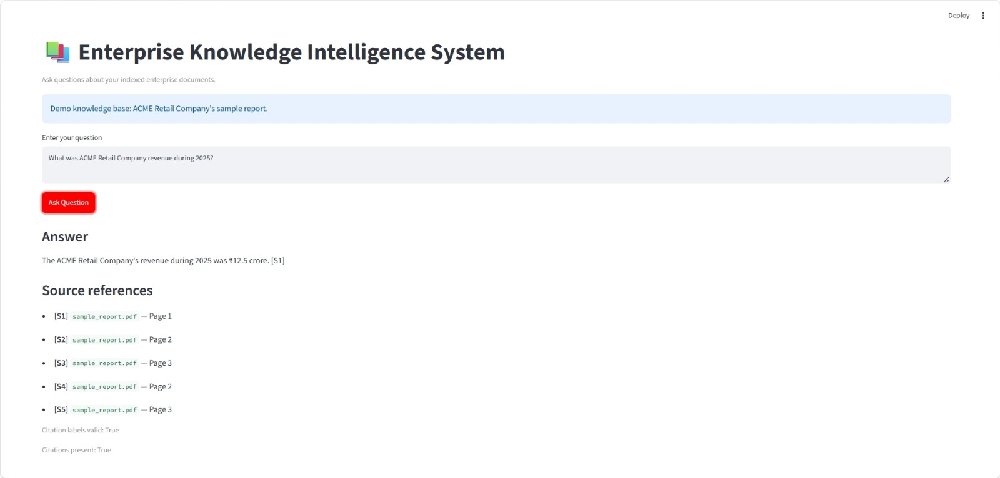

# Enterprise Knowledge Intelligence System

A production-oriented Retrieval-Augmented Generation (RAG) application that helps users query enterprise documents and receive context-grounded answers with source citations.

The system combines PDF ingestion, text chunking, semantic vector search, keyword-based retrieval, reranking, and local LLM-based answer generation. It also includes a FastAPI backend, Streamlit interface, automated tests, and an evaluation pipeline.

## Key Features

- **PDF ingestion:** Extract text and page metadata from PDF documents.
- **Text chunking:** Split documents into overlapping chunks for retrieval.
- **Semantic search:** Generate embeddings using Sentence Transformers.
- **Hybrid retrieval:** Combine vector search and BM25 keyword search.
- **Reranking:** Improve the relevance of retrieved passages using a cross-encoder.
- **Grounded answer generation:** Generate responses using a locally hosted Ollama model.
- **Source citations:** Validate citation identifiers in generated answers.
- **Abstention:** Support responses when the available document excerpts do not contain the requested information.
- **REST API:** Expose query and health-check endpoints through FastAPI.
- **Interactive interface:** Ask questions through a Streamlit application.
- **Evaluation and testing:** Evaluate RAG behavior and run automated tests.

## Architecture

```text
PDF Documents
     |
     v
PDF Text Extraction
     |
     v
Text Chunking + Metadata
     |
     v
Embedding Generation
     |
     v
Local Vector Store
     |
     v
Hybrid Retrieval
(Vector Search + BM25)
     |
     v
Cross-Encoder Reranking
     |
     v
Context-Grounded LLM
     |
     v
Answer + Source Citations
```

The application exposes its functionality through a FastAPI backend and a Streamlit user interface.


## ## Application Demo

The Streamlit interface lets users ask questions about indexed enterprise documents and view grounded answers with source citations.




## Technology Stack

| Component | Technology |
|---|---|
| Language | Python |
| API | FastAPI, Uvicorn |
| User interface | Streamlit |
| PDF processing | PyMuPDF |
| RAG components | LangChain |
| Embeddings | Sentence Transformers |
| Vector database | Qdrant |
| Keyword retrieval | BM25 |
| Reranking | Cross-Encoder |
| Local LLM runtime | Ollama |
| Testing | pytest, HTTPX |

## Project Structure

```text
enterprise-knowledge-intelligence-system/
├── api/
│   ├── main.py
│   └── schemas.py
├── app/
│   └── main.py
├── data/
│   ├── raw/
│   └── evaluation/
├── scripts/
│   ├── evaluate_rag.py
│   ├── index_pdf.py
│   └── ingest_documents.py
├── src/
│   ├── evaluation/
│   ├── generation/
│   ├── ingestion/
│   ├── retrieval/
│   ├── security/
│   ├── config.py
│   └── logging_config.py
├── tests/
├── storage/
├── .env.example
├── .gitignore
├── requirements.txt
└── README.md
```

Generated files, local databases, virtual environments, and other runtime artifacts may not be included in the repository.

## Prerequisites

- Python installed on your machine.
- Git.
- Ollama installed and running locally.
- Sufficient RAM and disk space for the embedding and reranking models.

The project was tested locally with Python 3.14.5. Compatibility with other Python versions depends on the installed dependency versions.

## Installation

### 1. Clone the repository

```bash
git clone <git clone https://github.com/raja819/enterprise-knowledge-intelligence-system.git
cd enterprise-knowledge-intelligence-system
```

Replace the placeholder with your actual GitHub repository URL.

### 2. Create and activate a virtual environment

Windows PowerShell:

```powershell
python -m venv .venv
.\.venv\Scripts\Activate.ps1
```

### 3. Install dependencies

```powershell
python -m pip install --upgrade pip
pip install -r requirements.txt
```

### 4. Configure environment variables

Copy the example configuration:

```powershell
Copy-Item .env.example .env
```

Review `.env.example` and the application's configuration before changing environment values. Keep actual credentials in `.env`; never commit secrets to Git.

### 5. Set up Ollama

Make sure Ollama is installed and running. Download the model used by the local setup:

```powershell
ollama pull qwen2.5:3b
```

Confirm that the model is available:

```powershell
ollama list
```

The local setup uses `qwen2.5:3b` for answer generation. The first run may also download embedding and reranking model files.

## Running the Application

Run commands from the repository root with the virtual environment activated.

### Start the FastAPI backend

```powershell
uvicorn api.main:app --reload
```

Open the interactive API documentation:

- Swagger UI: http://127.0.0.1:8000/docs
- Health endpoint: http://127.0.0.1:8000/health

### Start the Streamlit interface

Open a second terminal, activate the virtual environment, navigate to the repository root, and run:

```powershell
streamlit run app/main.py
```

Open the local URL printed by Streamlit, typically:

http://localhost:8501

### Query documents

Use the Streamlit interface or the API documentation to submit a question about the indexed documents.

The answer depends on the documents available to the retrieval pipeline. Ensure that the intended documents have been ingested and indexed before querying them.

## Document Ingestion

The repository contains these document-processing scripts:

- `scripts/ingest_documents.py`
- `scripts/index_pdf.py`

Inspect their argument handling or usage instructions before running them, since the required command-line arguments depend on the implementation.

A sample report is available at `data/raw/sample_report.pdf` in the development setup. It contains fictional ACME Retail Company business information for demonstration and testing.

## Evaluation

Run the RAG evaluation pipeline:

```powershell
python -m scripts.evaluate_rag
```

Evaluation results are written to the `data/evaluation/` directory.

The development evaluation suite checks behaviors such as answer matching, source/page matching, citation validity, and abstention on unsupported questions.

The current evaluation dataset is small and should be expanded before drawing conclusions about production accuracy.

## Automated Tests

Run the test suite from the repository root:

```powershell
python -m pytest -v
```

The development test run completed with **46 passing tests**.

Tests cover areas including:

- PDF loading and text chunking
- Hybrid retrieval and reranking
- Answer generation and citation validation
- Configuration and evaluation
- API behavior

Re-run the tests after making code or configuration changes.

## Example

A question supported by the sample report:

**Question:** What was ACME Retail Company revenue during 2025?

**Example answer:** The total revenue of ACME Retail Company in 2025 was ₹12.5 crore. [S1]

This is fictional demonstration data, not a real company's financial disclosure.

For unsupported questions, the application is intended to indicate when the supplied document excerpts do not provide enough information.

## Security and Responsible Use

- Never commit `.env`, API keys, credentials, or private business documents.
- Keep local databases and generated runtime files out of version control.
- Review retrieved evidence before relying on an answer for an important decision.
- Citation identifier validation does not, by itself, prove that every cited passage entails the generated claim.
- Evaluate the system with a larger and more diverse set of questions before production use.

## Current Limitations

- Retrieval quality depends on document quality, chunking, embedding models, and ranking configuration.
- Local LLM performance depends on available hardware.
- The evaluation dataset is currently small.
- Citation validation checks citation structure and identifiers; it is not a complete factuality or entailment assessment.
- Production deployment would require additional work on authentication, authorization, monitoring, load testing, data governance, and operational reliability.

## Future Improvements

- Expand the evaluation dataset and add retrieval metrics.
- Add document-level access controls and stronger security checks.
- Improve citation-to-claim verification.
- Add structured observability and latency monitoring.
- Add deployment automation and reproducible environment configuration.
- Evaluate retrieval and generation quality on larger enterprise document collections.

## License

Choose and add a license before distributing the project publicly.
